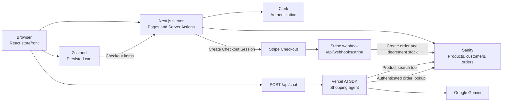
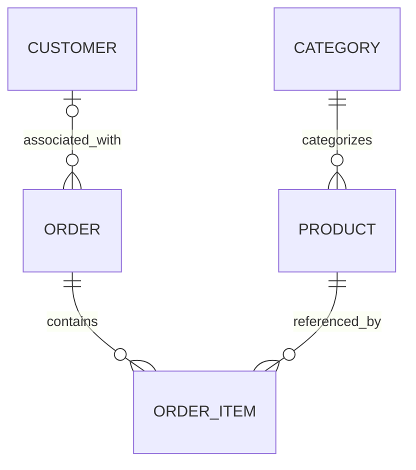

<div align="center">

# FurnitureHub — AI-Powered Furniture Store

</div>

<div align="center">

[](https://nextjs.org/)
[](https://react.dev/)
[](https://www.typescriptlang.org/)
[](https://tailwindcss.com/)
[](https://www.sanity.io/)
[](https://clerk.com/)
[](https://stripe.com/)
[](https://ai.google.dev/)

</div>

FurnitureHub combines a furniture catalog, shopping cart, checkout workflow, customer accounts, order history, and conversational product discovery in one web application.

The application uses Next.js App Router for its pages and server-side functionality. Sanity provides the content backend for products, categories, customers, and orders. Clerk manages customer authentication, Stripe handles payment checkout, and Google's Gemini model powers the shopping assistant.

## Problem Statement

Furniture shopping often requires customers to compare products across several attributes, check availability, maintain a shopping list, and navigate separate account and purchase workflows.

FurnitureHub brings these tasks into a single application. It provides structured product filtering, persistent cart state, server-side price and stock checks during checkout, payment processing through Stripe, and a conversational interface for product discovery. Clerk supplies customer authentication, while Sanity stores the catalog and order-related records.

The AI assistant provides an alternative way to discover products without relying exclusively on manual navigation and filters.

## Key Features

### 🤖 AI Shopping Assistant

- **Tool-Calling Agent** — A `ToolLoopAgent` (Vercel AI SDK) running Google's Gemini 3.8 Flash, with two Zod-validated tools (`searchProducts`, `getMyOrders`) and tightly scoped system instructions defining exact category/material/color enums and a one-call-per-query discipline.
- **Conversational Commerce UI** — Tool results render as the same `ProductCardWidget` / `OrderCardWidget` components used on the storefront, not raw text or markdown tables, so AI-sourced results feel native to the app.
- **Contextual Cross-Sell** — An "Ask AI for similar products" button on every product page pre-loads the chat with a prompt instructing the agent to search the same category/material while explicitly excluding the current item.
- **Streamed Responses** — Replies render token-by-token via the AI SDK's UI message stream, instead of waiting for a full completion.

### 🛍️ Storefront & Product Discovery

- Server-rendered catalog with faceted filtering — category, material, color, price range, and in-stock-only — resolved entirely in GROQ on the server.
- Dedicated relevance-scoring query (`score()`/`boost()`) that weights free-text matches in a product's **name** above matches in its **description**.
- Featured products carousel, category tiles, and a dedicated product detail page with a media gallery.

### 🛒 Cart & Checkout

- Persistent cart with quantity merging for duplicate items and live stock re-validation against the cart (`useCartStock`) before checkout.
- Stripe Checkout Sessions with shipping-address collection across 50+ supported countries.
- Cart contents are independently re-validated against live Sanity price and stock — server-side — immediately before a session is created.

### 📦 Order Management

- Authenticated order history and detail pages, scoped per Clerk user.
- Idempotent, signature-verified Stripe webhook that creates the order record and atomically decrements stock for every line item in a single Sanity transaction.
- Status lifecycle (`paid` → `shipped` → `delivered`/`cancelled`) with a centralized config driving badges, emoji, and icon styling everywhere it's displayed.

### 🔐 Auth & Access Control

- Full authentication lifecycle via **Clerk** — sign in/up, session management, and a `UserButton` with custom menu items.
- Edge-level route protection (`proxy.ts` + `createRouteMatcher`) guarding `/checkout`, `/checkout/success`, and `/orders/*` before any page code executes.
- Server-resolved identity passed into the AI agent factory — the client cannot influence which user's orders the agent is permitted to query.

### 🧩 Content Management (Sanity Studio)

- An embedded Sanity Studio at `/studio` — no separate deployment — for managing products, categories, orders, and customers.
- Grouped, validated content schemas (required fields, positive-price rules, non-negative integer stock) enforced at the schema level, not just in application code.
- Real-time content sync to the storefront via Sanity's Live Content API.

## Real-World Use Cases

- **🛋️ Find furniture for a room:** Browse categories and narrow products by material, color, price range, and stock.
- **🔎 Compare product options:** Sort results by price or relevance and open product detail pages to review available specifications.
- **🛒 Prepare a purchase:** Add products to the cart, adjust quantities, and review stock warnings before checkout.
- **💳 Complete a purchase:** Sign in and continue to Stripe's hosted checkout after the server verifies current stock and prices.
- **📦 Review past purchases:** Open the order-history page or ask the authenticated shopping assistant about previous orders and their statuses.
- **💬 Discover products conversationally:** Ask the assistant to search for furniture using a material, color, category, or price range.
- **🗂️ Maintain the catalog:** Use Sanity Studio to manage categories, product content, inventory fields, customer records, and orders.

## Tech Stack

| Technology          | Purpose                                                                           |
| ------------------- | --------------------------------------------------------------------------------- |
| ⚡ `Next.js`        | Routing, server components, Server Actions, one Route Handler                     |
| ⚛️ `React`          | Component model, Suspense-driven loading states                                   |
| 🔵 `TypeScript`     | End-to-end type safety, including types generated directly from the Sanity schema |
| 🎨 `Tailwind CSS`   | Utility-first, mobile-first styling with dark-mode variants throughout            |
| 🧩 `shadcn/ui`      | UI component setup and styling conventions                                        |
| 🟥 `Sanity`         | Headless CMS for structured content management and schema-driven content delivery |
| 🔐 `Clerk`          | Authentication, user sessions, route protection, and email lookup for alerts      |
| 💳 `Stripe`         | Payment processing for secure online checkout and transactions                    |
| 🐻 `Zustand`        | Per-request-scoped cart and chat UI stores via React Context                      |
| 📝 `React-Markdown` | Safely renders the AI agent's streamed markdown responses                         |
| 🎯 `Lucide React`   | Interface icons                                                                   |
| 🔔 `Sonner`         | Toast notifications                                                               |
| ☁️ `Vercel`         | Deployment                                                                        |

## System Architecture and Data Flow

The application uses the Next.js App Router. Storefront pages and data queries use Sanity; Clerk supplies customer identity; the cart state is managed in Zustand; checkout and customer handling use Server Actions; payment events arrive through the Stripe webhook Route Handler; and the shopping assistant uses the Vercel AI SDK with Google's Gemini provider. Sanity has a read client configured with CDN support and a separate write client for mutations.



### Product discovery flow

1. The homepage reads URL search parameters such as `q`, `category`, `color`, `material`, `minPrice`, `maxPrice`, `sort`, and `inStock`.
2. The page selects the relevant GROQ query and retrieves products, categories, and featured products from Sanity.
3. The product filters update the URL query parameters, allowing the catalog to reflect the selected filters and sorting option.
4. A product detail page looks up one product by `slug.current` and renders its gallery and information.

### Cart and checkout flow

1. Storefront components add or update cart items through the Zustand cart store. The store persists the `items` state in browser storage under `cart-storage`.
2. The checkout Server Action checks that the customer is authenticated and the cart is not empty.
3. It fetches the referenced products from Sanity and rejects missing products, products with no stock, or quantities greater than the current stock.
4. Stripe line items are built using product prices retrieved from Sanity, not the browser's cart price values.
5. The action gets or creates the Stripe customer and corresponding Sanity customer record, then creates a Stripe Checkout Session.
6. Stripe redirects to the configured success or cancellation URL. The success-page action retrieves the session and checks that its metadata belongs to the current Clerk user.

### Payment webhook flow

The webhook route reads the raw request body and the `stripe-signature` header, then verifies the event using `STRIPE_WEBHOOK_SECRET`. For `checkout.session.completed`, it checks for an order with the same Stripe payment ID, reads the session metadata and Stripe line items, creates a Sanity order, and decrements stock for the purchased product IDs in a Sanity transaction.

### AI shopping assistant flow

1. The chat component sends UI messages to `POST /api/chat` using the AI SDK React integration.
2. The route obtains the optional Clerk user ID and creates the shopping agent.
3. The agent uses the configured `gemini-3.8-flash` model and can invoke `searchProducts`.
4. The `getMyOrders` tool is registered only when a user is authenticated and queries orders using that user's Clerk ID.
5. The route returns an AI SDK-managed stream for the chat interface to render.

The `proxy.ts` middleware protects `/checkout`, `/checkout/success`, `/orders`, and paths beginning with `/orders/`.

## Folder Structure

```text
ai-ecommerce-furniture-store/
├── actions/
│   ├── checkout.ts                  # Stripe checkout session actions
│   └── customer.ts                  # Stripe and Sanity customer records
├── app/
│   ├── (store)/
│   │   ├── (auth)/                  # Clerk sign-in and sign-up pages
│   │   ├── checkout/                # Checkout and success pages
│   │   ├── orders/                  # Order history and current detail-page location
│   │   ├── products/[slug]/         # Product detail page
│   │   ├── layout.tsx               # Storefront layout and providers
│   │   └── page.tsx                 # Homepage and product catalog
│   ├── api/
│   │   ├── chat/route.ts            # AI shopping assistant endpoint
│   │   └── webhooks/stripe/route.ts # Stripe webhook handler
│   ├── studio/[[...tool]]/          # Embedded Sanity Studio route
│   ├── globals.css
│   └── layout.tsx                   # Root layout and metadata
├── components/
│   ├── store/                       # Storefront, cart, checkout, order, and chat UI
│   └── ui/                          # Reusable interface components
├── hooks/
│   ├── use-cart-stock.ts            # Cart stock checks
│   └── use-mobile.ts                # Mobile viewport hook
├── lib/
│   ├── ai/
│   │   ├── shopping-agent.ts        # Gemini agent and tool registration
│   │   └── tools/
│   │       ├── get-my-orders.ts     # Authenticated order lookup tool
│   │       └── search-products.ts   # Sanity-backed product search tool
│   ├── constants/                   # Filter, stock, and order-status constants
│   ├── store/                       # Zustand cart and chat stores/providers
│   └── utils.ts                     # Shared utility functions
├── sanity/
│   ├── lib/                         # Sanity client, image helpers, and live queries
│   ├── queries/                     # Product, category, customer, and order GROQ queries
│   ├── schemaTypes/                 # Category, product, customer, and order schemas
│   ├── env.ts                       # Sanity environment configuration
│   └── structure.ts                 # Studio navigation structure
├── sample-data.ndjson               # Optional Sanity sample documents
├── schema.json                      # Extracted Sanity schema
├── sanity.types.ts                  # Generated Sanity query types
├── sanity.config.ts                 # Sanity Studio configuration
├── sanity.cli.ts                    # Sanity CLI project configuration
├── proxy.ts                         # Clerk middleware and protected routes
├── next.config.ts                   # Remote image host configuration
├── components.json                  # UI component configuration
├── eslint.config.mjs
├── postcss.config.mjs
├── tsconfig.json
├── package.json
├── package-lock.json
└── .gitignore
```

## Database Schema

FurnitureHub uses Sanity documents rather than a traditional SQL database. The application defines four document types in `sanity/schemaTypes/`. Sanity manages the document identifiers and stores references between documents; the order's line items are embedded objects, not a separate document type.

#### **`category`**

| Field   | Type             | Description                                                          |
| ------- | ---------------- | -------------------------------------------------------------------- |
| `_id`   | Sanity system ID | Unique document identifier                                           |
| `title` | `string`         | Category display name; required                                      |
| `slug`  | `slug`           | URL-friendly identifier; required and generated from title in Studio |
| `image` | `image`          | Optional category thumbnail with hotspot support                     |

#### **`product`**

| Field              | Type             | Description                                                         |
| ------------------ | ---------------- | ------------------------------------------------------------------- |
| `_id`              | Sanity system ID | Unique document identifier                                          |
| `name`             | `string`         | Product name; required                                              |
| `slug`             | `slug`           | URL-friendly identifier; required and generated from name in Studio |
| `description`      | `text`           | Optional product description                                        |
| `price`            | `number`         | Required positive price in GBP                                      |
| `category`         | `reference`      | Required reference to a `category` document                         |
| `material`         | `string`         | Optional value from the supported material list                     |
| `color`            | `string`         | Optional value from the supported color list                        |
| `dimensions`       | `string`         | Optional dimensions text                                            |
| `images`           | Array of `image` | Product images; schema requires at least one                        |
| `stock`            | `number`         | Inventory count; defaults to `0`, must be a non-negative integer    |
| `featured`         | `boolean`        | Defaults to `false`; marks a featured product                       |
| `assemblyRequired` | `boolean`        | Defaults to `false`; indicates assembly is required                 |

Supported material values are `wood`, `metal`, `fabric`, `leather`, and `glass`. Supported color values are `black`, `white`, `oak`, `walnut`, `grey`, and `natural`. The low-stock threshold in `lib/constants/stock.ts` is five units.

#### **`customer`**

| Field              | Type             | Description                                            |
| ------------------ | ---------------- | ------------------------------------------------------ |
| `_id`              | Sanity system ID | Unique document identifier                             |
| `email`            | `string`         | Required customer email                                |
| `name`             | `string`         | Optional customer name                                 |
| `clerkUserId`      | `string`         | Optional Clerk user ID                                 |
| `stripeCustomerId` | `string`         | Required Stripe customer ID; read-only in Studio       |
| `createdAt`        | `datetime`       | Defaults to the current timestamp; read-only in Studio |

#### **`order`**

| Field                     | Type                       | Description                                                                                       |
| ------------------------- | -------------------------- | ------------------------------------------------------------------------------------------------- |
| `_id`                     | Sanity&nbsp;system&nbsp;ID | Unique document identifier                                                                        |
| `orderNumber`             | `string`                   | Required order number; read-only in Studio                                                        |
| `items`                   | Array of objects           | Embedded purchased line items                                                                     |
| `items[].product`         | `reference`                | Required reference to a `product` document                                                        |
| `items[].quantity`        | `number`                   | Required quantity; minimum `1`, initial value `1`                                                 |
| `items[].priceAtPurchase` | `number`                   | Required price stored for the item at purchase                                                    |
| `total`                   | `number`                   | Order total in GBP; read-only in Studio                                                           |
| `status`                  | `string`                   | Initial value `paid`; available values are `paid`, `shipped`, `delivered`, and `cancelled`        |
| `customer`                | `reference`                | Optional reference to a `customer` document                                                       |
| `clerkUserId`             | `string`                   | Optional Clerk user ID associated with the order                                                  |
| `email`                   | `string`                   | Optional customer email                                                                           |
| `address`                 | `object`                   | Optional shipping address with `name`, `line1`, `line2`, `city`, `postcode`, and `country` fields |
| `stripePaymentId`         | `string`                   | Optional Stripe payment intent ID; read-only in Studio                                            |
| `createdAt`               | `datetime`                 | Defaults to the current timestamp; read-only in Studio                                            |

### Entity relationship overview

The following diagram represents the application's logical document relationships. `ORDER_ITEM` is an explanatory name for an embedded object inside `order.items`; it is not a separate Sanity document type.



An order also stores the Clerk user identifier as a string. This is how the application associates the order with the authenticated customer when querying order history.

### Constraints, indexes, and migrations

The schema defines field validation and initial values, including:

- Required product names, slugs, prices, and category references.
- Positive product prices.
- At least one product image.
- Non-negative integer inventory.
- Required customer email and Stripe customer ID.
- Required order numbers and line-item product references.
- Line-item quantities of at least one.

### Sample data

The root-level `sample-data.ndjson` contains 36 sample documents: six categories, 23 products, three customers, and four orders.

## API Reference

#### `POST /api/chat`

Accepts chat messages for the AI shopping assistant and returns an AI SDK-managed streaming response.

**Request body**

The route expects a JSON object with a `messages` property typed as `UIMessage[]` from the AI SDK. A representative user message has this shape:

```json
{
  "messages": [
    {
      "id": "example-message-id",
      "role": "user",
      "parts": [
        {
          "type": "text",
          "text": "Find walnut dining tables under £500."
        }
      ]
    }
  ]
}
```

**Example**

```bash
curl -X POST http://localhost:3000/api/chat \
  -H "Content-Type: application/json" \
  -d '{
    "messages": [
      {
        "id": "example-message-id",
        "role": "user",
        "parts": [
          {
            "type": "text",
            "text": "Find walnut dining tables under £500."
          }
        ]
      }
    ]
  }'
```

**Authentication and behavior**

- Clerk authentication is optional for product search.
- The agent registers `searchProducts` for all requests.
- The `getMyOrders` tool is registered only when a Clerk user ID is available and queries only that user's orders.
- Product search supports a search term, category slug, material, color, minimum price, and maximum price; the underlying query returns up to 20 products.
- The route does not define a custom fixed JSON response body, pagination contract, explicit rate limit, or application-specific error envelope. It returns the stream created by `createAgentUIStreamResponse`.

#### `POST /api/webhooks/stripe`

Receives Stripe webhook events. It must be called by Stripe or a compatible local webhook forwarder using a valid signature; it is not a browser checkout endpoint.

| Header             | Value / purpose                                                                            |
| ------------------ | ------------------------------------------------------------------------------------------ |
| `stripe‑signature` | Required signature header used to verify the raw request body with `STRIPE_WEBHOOK_SECRET` |

The handler processes `checkout.session.completed`. It checks whether an order already exists for the Stripe payment ID, creates a Sanity order using checkout metadata and Stripe line items, and decrements product stock in a Sanity transaction. Other event types are logged as unhandled.

**Success (`200 OK`)**

```json
{
  "received": true
}
```

**Error responses implemented by the route**

| Status | Response `error`                  | Condition                                              |
| ------ | --------------------------------- | ------------------------------------------------------ |
| `400`  | `Missing stripe-signature header` | Request does not contain the required signature header |
| `400`  | `Webhook Error: ...`              | Stripe signature verification failed                   |

### Checkout Server Actions

These are Next.js Server Actions, not separate HTTP API routes.

| Server Action                                         | Input                                   | Behavior and result shape                                                                                                                                                                                                         |
| ----------------------------------------------------- | --------------------------------------- | --------------------------------------------------------------------------------------------------------------------------------------------------------------------------------------------------------------------------------- |
| `createCheckoutSession(items)`                        | `CartItem[]`                            | Requires a signed-in user, rejects an empty cart, fetches current products from Sanity, validates availability and quantities, and creates a Stripe Checkout Session. Returns `{ success, url? }` or `{ success: false, error }`. |
| `getCheckoutSession(sessionId)`                       | Stripe Checkout Session ID              | Requires authentication and checks the session's `clerkUserId` metadata. Returns `{ success, session }` with checkout details or `{ success: false, error }`.                                                                     |
| `getOrCreateStripeCustomer(email, name, clerkUserId)` | Customer email, name, and Clerk user ID | Looks up the Sanity customer by email, reuses or creates a Stripe customer, and creates or updates the Sanity customer record.                                                                                                    |

Checkout is configured for card payments and collects shipping addresses from a fixed list of supported countries in `actions/checkout.ts`. Prices are built from current Sanity product data in GBP.

## External Integrations

### 1. Sanity

**Purpose:** Store product catalog, categories, customers, and orders.

**Implementation:** `sanity/lib/client.ts`, `sanity/lib/live.ts`, `sanity/queries/`, and `sanity/schemaTypes/`.

The application uses `next-sanity` to connect to Sanity, define GROQ queries, and integrate live-query functionality. The embedded Studio is available at `/studio`.

The read client is configured with CDN support. A separate write client is configured without the CDN and uses `SANITY_API_WRITE_TOKEN`.

### 2. Clerk

**Purpose:** Customer sign-in, registration, and identity management.

**Implementation:** `app/(store)/layout.tsx`, `proxy.ts`, and authentication calls throughout the order and checkout functionality.

The application uses `ClerkProvider`, `auth()`, `currentUser()`, and Clerk UI components. The middleware specifically protects checkout and order-related routes.

### 3. Stripe

**Purpose:** Payment checkout, Stripe customer records, payment session retrieval, and payment-event processing.

**Implementation:** `actions/checkout.ts`, `actions/customer.ts`, and `app/api/webhooks/stripe/route.ts`.

The application uses the Stripe SDK to create hosted Checkout Sessions and handles the `checkout.session.completed` webhook event. Signature verification is performed before processing webhook events.

The Stripe clients in the repository use API version `2026-09-30.endive`.

### 4. Google Generative AI

**Purpose:** Natural-language shopping assistance and tool-based product or order retrieval.

**Implementation:** `lib/ai/shopping-agent.ts` and `lib/ai/tools/`.

The application uses `@ai-sdk/google` with the configured model identifier `gemini-3.8-flash`. The Vercel AI SDK provides agent execution, tool invocation, and response streaming.

### 5. Remote product imagery

The Next.js image configuration allows remote images from these HTTPS hosts:

- `cdn.sanity.io`
- `images.unsplash.com`

The supplied sample content includes Unsplash image references. These hosts are configured for image delivery; this does not establish that a separate Unsplash API integration exists.

## Environment Variables

#### Example `.env`

```bash
# Clerk authentication
NEXT_PUBLIC_CLERK_PUBLISHABLE_KEY=your-clerk-publishable-key
CLERK_SECRET_KEY=your-clerk-secret-key

# Sanity
NEXT_PUBLIC_SANITY_PROJECT_ID=your-sanity-project-id
NEXT_PUBLIC_SANITY_DATASET=your-development-dataset
SANITY_API_WRITE_TOKEN=your-sanity-write-token

# Google Generative AI
GOOGLE_GENERATIVE_AI_API_KEY=your-google-api-key

# Stripe
STRIPE_SECRET_KEY=your-stripe-secret-key
STRIPE_WEBHOOK_SECRET=your-stripe-webhook-signing-secret

# Application base URL; optional fallback is http://localhost:3000
NEXT_PUBLIC_BASE_URL=http://localhost:3000
```

### Local configuration notes

- The Sanity dataset and project ID must match the intended Sanity project.
- The Sanity write token needs sufficient permissions for the application's customer, order, and inventory mutations.
- A Clerk application must be configured with its publishable and secret keys.
- Stripe credentials should be configured for the intended test or production environment.
- The webhook secret must match the Stripe endpoint or local Stripe CLI listener that sends events to the application.
- The application must be restarted after changing local environment variables.

The repository's `.gitignore` excludes environment files matching `.env*`. Keep credential files local and out of version control.

## Prerequisites

- **Node.js 20.9 or later:** The minimum required by the installed Next.js major version; use a compatible Node.js release for Next.js 16.
- **npm:** Used to install dependencies; `package-lock.json` is included in the repository.
- **Sanity project and dataset:** The dataset needs category and product documents for a populated storefront. A write token is required for customer, order, and inventory mutations.
- **Clerk application:** Required for sign-in, sign-up, and protected customer flows.
- **Google Generative AI credentials:** Required for the AI shopping assistant.
- **Stripe account and API credentials:** Required for checkout and webhook processing.
- **Stripe CLI (for local webhook testing):** Optional for browsing the storefront, but useful for forwarding Stripe events to the local webhook route.

## Installation and Local Setup

1. **Clone or open the repository**

   If you have access to the Git repository, clone the verified URL and enter the project directory.

   ```bash
   git clone https://github.com/jyothikaogeti/ai-ecommerce-furniture-store.git
   cd ai-ecommerce-furniture-store
   ```

2. **Install dependencies**

   ```bash
   npm install
   ```

3. **Configure environment variables**

   Create `.env` in the root and add the Clerk, Sanity, Google Generative AI, and Stripe. Use test credentials for Stripe during local development.

4. **Configure Sanity**

   Create or select a Sanity project and development dataset. Set `NEXT_PUBLIC_SANITY_PROJECT_ID` and `NEXT_PUBLIC_SANITY_DATASET`. Ensure the write token has permissions for the writes performed by customer creation, order creation, and stock updates.

5. **Optionally import sample content**

   Authenticate the Sanity CLI for your project and import `sample-data.ndjson` into a development dataset:

   ```bash
   npx sanity dataset import sample-data.ndjson your-development-dataset
   ```

   Replace `your-development-dataset` with your dataset name. Do not import sample content into a production dataset without reviewing its contents first.

6. **Start the development server**

   ```bash
   npm run dev
   ```

7. **Optionally forward Stripe webhooks locally**

   Install and authenticate the Stripe CLI separately, then run:

   ```bash
   stripe listen --forward-to localhost:3000/api/webhooks/stripe
   ```

   Set `STRIPE_WEBHOOK_SECRET` to the signing secret printed by the local listener. The route handles the `checkout.session.completed` event.

8. **Verify locally**
   - Confirm categories and products appear from the configured Sanity dataset.
   - Test product search, category/material/color/price filters, stock filtering, and sorting.
   - Add products to the cart and verify that cart items persist after a page reload.
   - Test Clerk sign-in and sign-up.
   - Test the AI assistant with valid Google credentials.
   - Use Stripe test mode to exercise checkout, then inspect webhook logs and the Sanity dataset to verify order creation and inventory changes.

## Available Scripts

The `package.json` defines the following npm scripts.

| Command           | Purpose                                                           |
| :---------------- | :---------------------------------------------------------------- |
| `npm run dev`     | Starts the Next.js development server.                            |
| `npm run build`   | Builds the application for production.                            |
| `npm run start`   | Starts the built application using the Next.js production server. |
| `npm run lint`    | Runs ESLint using the repository's configuration.                 |
| `npm run typegen` | Generates Sanity TypeScript types with required fields enforced.  |

The type-generation command runs:

```bash
sanity schema extract --enforce-required-fields && sanity typegen generate
```

The script is intended to update the generated schema information and types. Review generated-file changes before committing them.

## Deployment

- Build the application with `npm run build` and serve the build with `npm run start` in a Node.js environment compatible with the installed Next.js version.
- Configure the production Clerk, Sanity, Google Generative AI, and Stripe environment variables in the hosting platform.
- Point `NEXT_PUBLIC_BASE_URL` to the production application URL, or ensure the deployment URL fallbacks are set correctly.
- Confirm that the production Sanity project and dataset have the expected schemas and content, and that `SANITY_API_WRITE_TOKEN` can perform the required mutations.
- Register the deployed `/api/webhooks/stripe` route as a Stripe webhook endpoint and configure the matching `STRIPE_WEBHOOK_SECRET` in the host.
- Test a complete checkout and verify the matching order and inventory updates in the intended Sanity dataset before accepting production payments.

## Troubleshooting

| Symptom                                                      | Likely Cause / Solution                                                                                                                                                                                                             |
| ------------------------------------------------------------ | ----------------------------------------------------------------------------------------------------------------------------------------------------------------------------------------------------------------------------------- |
| **Sanity queries fail or the storefront is empty**           | Verify `NEXT_PUBLIC_SANITY_PROJECT_ID` and `NEXT_PUBLIC_SANITY_DATASET`, confirm the selected dataset contains categories/products, and check that the project is accessible.                                                       |
| **Sanity writes fail during checkout or webhook processing** | Verify `SANITY_API_WRITE_TOKEN` and its permissions for creating customer/order documents and updating product stock.                                                                                                               |
| **Clerk authentication fails**                               | Check `NEXT_PUBLIC_CLERK_PUBLISHABLE_KEY` and `CLERK_SECRET_KEY`, review Clerk application configuration, and restart the development server after environment changes.                                                             |
| **Checkout cannot create a session**                         | Confirm the user is signed in, the cart is not empty, products exist, requested quantities do not exceed current stock, and `STRIPE_SECRET_KEY` is valid. Review server logs for the underlying error.                              |
| **Stripe webhook returns `400`**                             | Check that `stripe-signature` is present and that `STRIPE_WEBHOOK_SECRET` matches the secret for the sender or local Stripe CLI listener.                                                                                           |
| **A webhook is acknowledged but no order appears**           | Check server logs for missing checkout metadata or Sanity write failures. The route can return `{ "received": true }` after logging missing metadata without creating an order.                                                     |
| **AI assistant requests fail**                               | Verify `GOOGLE_GENERATIVE_AI_API_KEY`, confirm the configured Google account can access `gemini-3.8-flash`, and check server logs and Sanity connectivity for tool errors.                                                          |
| **Product detail links fail**                                | The product page resolves by slug. Links should use a product slug, not a Sanity document ID.                                                                                                                                       |
| **Order detail links fail**                                  | The current detail page is in `app/(store)/orders/id/page.tsx`, which is a literal `id` segment in Next.js, while links generate `/orders/<order-id>`. The directory and link format need to be aligned for a dynamic detail route. |
| **Remote product images do not load**                        | Check that image URLs use the HTTPS hosts allowed in `next.config.ts`: `cdn.sanity.io` or `images.unsplash.com`.                                                                                                                    |
| **Dependency installation or build fails**                   | Confirm the Node.js version is compatible with Next.js 16, run `npm install`, then inspect the output from `npm run lint` or `npm run build`.                                                                                       |

## Learning Outcomes

- **Next.js App Router and Server Actions** — Organizes storefront pages, checkout operations, and Route Handlers in a modern React framework.
- **Sanity Content Modeling** — Defines category, product, customer, and order documents and retrieves data through GROQ queries.
- **Authentication and Authorization** — Uses Clerk identity for protected checkout/order pages and user-scoped order queries.
- **Shopping Cart State** — Uses Zustand with browser persistence to manage cart items and quantities.
- **Payment Integration** — Creates Stripe Checkout Sessions, verifies signed webhook events, writes order records, and updates stock.
- **AI Tool Calling** — Connects a Gemini-backed agent to product search and authenticated order lookup tools.
- **Streaming UI** — Uses the Vercel AI SDK to connect the chat UI to the server-side shopping agent.
- **Environment and Integration Configuration** — Separates server secrets from public configuration for Sanity, Clerk, Google Generative AI, and Stripe.
